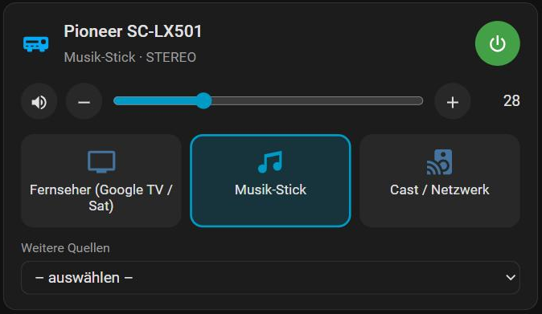

# Receiver-Karte

AV-Receiver: Ein/Aus, Lautstärke, Quellen als Tasten, Klangmodus und laufender Titel



## Installation

### Über den Marketplace (Home Assistant 2026.11 und neuer)

1. **Einstellungen** → **Marketplace** → **Aus Link hinzufügen**.
2. Die Adresse dieses Repositorys eintragen, Kategorie **Dashboard**.
3. **Receiver-Karte** installieren. Die Ressource wird dabei automatisch eingetragen.

### Über HACS (ältere Versionen)

**HACS** → ⋮ → **Benutzerdefinierte Repositories** → Adresse dieses Repositorys, Typ **Dashboard** → installieren.

### Manuell

`receiver-karte.js` nach `/config/www/` kopieren und unter **Einstellungen** → **Dashboards** → ⋮ → **Ressourcen**
als JavaScript-Modul `/local/receiver-karte.js` eintragen.

## Verwendung

```yaml
type: custom:receiver-karte
```

## Konfiguration

```
Receiver-Karte: AV-Receiver in einer Karte (Ein/Aus, Lautstaerke, Quellen als Tasten,
weitere Quellen als Auswahl, Klangmodus, laufender Titel ueber einen Abspieler wie Music Assistant).

  type: custom:receiver-karte
  entity: media_player.pioneer_av_receiver          # Hauptzone (Quelle, Lautstaerke)
  player: media_player.pioneer_sc_lx501_4d60b5_2    # optional, Abspieler fuer Titel/Cover/Play
  name: Receiver                                    # optional
  quellen:                                          # Haupttasten (Rest unter "Weitere Quellen")
    - { quelle: TV, name: TV, icon: mdi:television }
    - { quelle: Strm-box, name: Google TV, icon: mdi:google-play }
    - { quelle: Network, name: Cast / Netzwerk, icon: mdi:cast-audio }
  weitere: true                                     # optional, Auswahl fuer die uebrigen Quellen
```

## Lizenz

MIT
